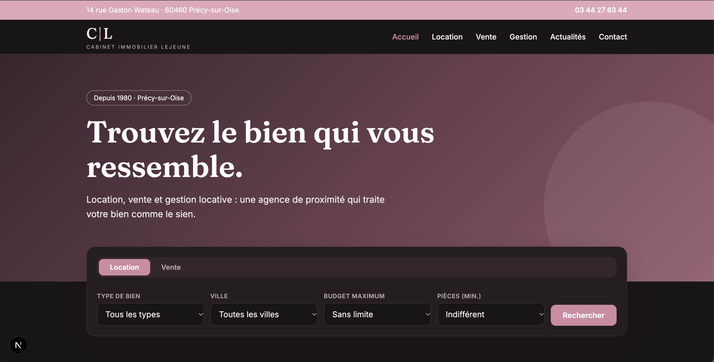

# Cabinet Immobilier Lejeune – redesign (Next.js)



## About

Modern and high-performance redesign of the existing Cabinet Lejeune showcase website, fully rebuilt with Next.js to optimize speed, SEO, and user experience.

## Tech Stack

- Next.js
- JavaScript / CSS
- Deployed on Vercel

## Getting Started

```bash
npm install
npm run dev
```

Then open http://localhost:3000 in your browser.

## Data and Forms

Property data is stored in `data/biens.js`. The forms are demo-only and still need to be connected to an API route.
